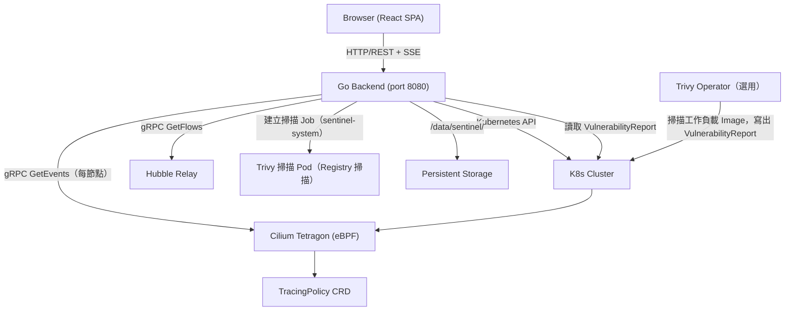
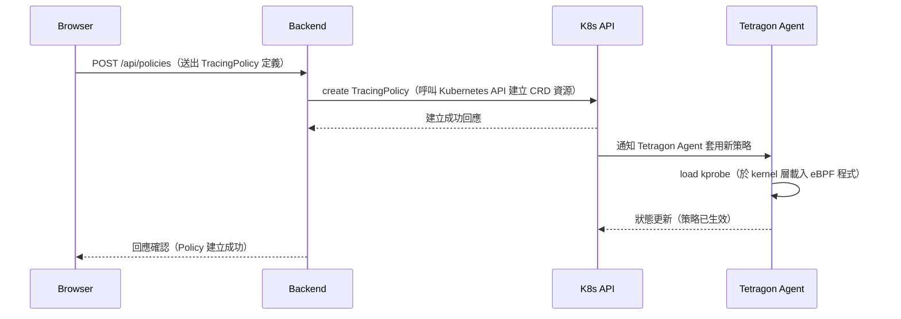

# 架構說明

## 系統架構圖

下圖說明 K8s Sentinel 各元件之間的部署關係與通訊路徑：

## 元件說明

| 元件 | 技術 | 說明 |
|---|---|---|
| Frontend | TypeScript + React + Vite + shadcn/ui | 網頁操作介面，以 SPA 形式提供 TracingPolicy 管理、事件檢視與叢集監控等功能 |
| Backend | Go 1.x + HTTP Server (port 8080) | 提供 RESTful API 服務，內建 Kubernetes 客戶端，負責與叢集溝通並處理使用者驗證 |
| Cilium Tetragon | eBPF DaemonSet | 部署於每個 Kubernetes Node 的安全觀測代理程式，透過 eBPF 技術於 kernel 層捕捉系統呼叫與檔案存取事件；K8s Sentinel 以 gRPC（`GetEvents`）逐節點串流收集事件 |
| Hubble Relay | Cilium 元件 | 將所有節點的網路 flow 彙整在單一 gRPC 端點，供 K8s Sentinel 以 `GetFlows` 串流讀取，作為 Network Topology 的資料來源 |
| Trivy Operator | 選用元件（Helm，安裝於 `sentinel-system`） | 掃描執行中工作負載的 Image 並寫出 `VulnerabilityReport`；K8s Sentinel 只讀取報告，不自行掃描工作負載（v0.60+） |
| Trivy 掃描 Pod | Kubernetes Job（`sentinel-system`） | [Registry 掃描](./features/registry-scanning.md)時由 K8s Sentinel 啟動，每個 Image 一個短命 Pod（v0.62+） |
| TracingPolicy | Kubernetes CRD (cilium.io/v1alpha1) | 定義 Tetragon 所要追蹤的 kprobe 規則與安全策略的自訂資源定義 |
| Persistent Storage | /data/sentinel/ | 本機持久化路徑：使用者帳號、JWT 簽署金鑰、Alerts 與 Syslog 設定、自訂範本、事件歷史與 Audit Log、Registry 設定與掃描結果 |

## 資料流說明

以下循序圖說明使用者透過 K8s Sentinel 建立一條新 TracingPolicy 的完整流程：

## 部署架構

K8s Sentinel 採用**單一 binary 部署**模式，大幅簡化安裝流程：

Go backend 在編譯時透過 `embed.go` 將前端 React SPA 的靜態檔案（HTML、JavaScript、CSS）完整內嵌至 binary 中。部署時只需複製並執行單一可執行檔，無需額外的 Web 伺服器或靜態檔案服務。

持久化資料存放於以下路徑：

| 路徑 | 用途 |
|---|---|
| `/data/sentinel/users.json` | 使用者帳號與密碼雜湊 |
| `/data/sentinel/.jwt-secret` | JWT Token 簽署金鑰，首次啟動時自動產生；v0.53 起可被 `JWT_SECRET` 環境變數覆蓋 |
| `/data/sentinel/`（其餘） | Alerts / Syslog 設定、自訂 Policy Templates、Security / Admission 事件歷史、Audit Log |
| `/data/sentinel/registries.json` | Registry 掃描的 Registry 設定（含認證） |
| `/data/sentinel/registry-scans/` | Registry 掃描結果，每個 Registry 一個目錄 |
